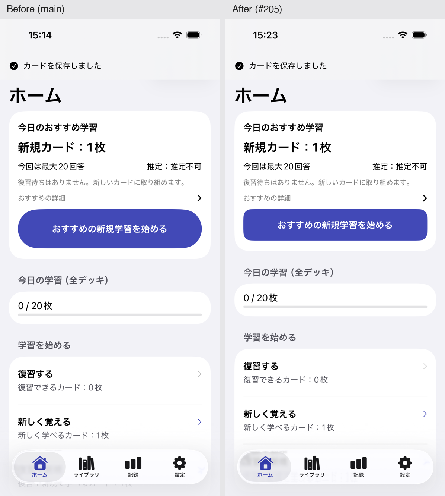
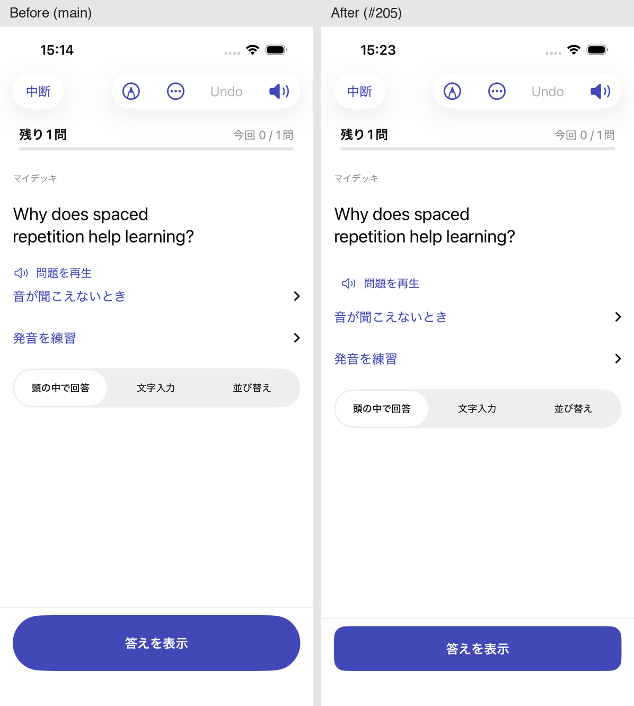
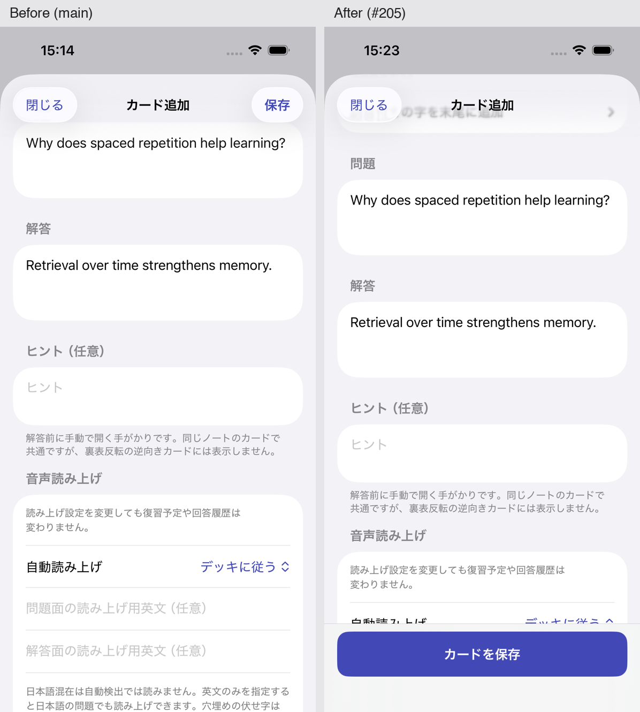
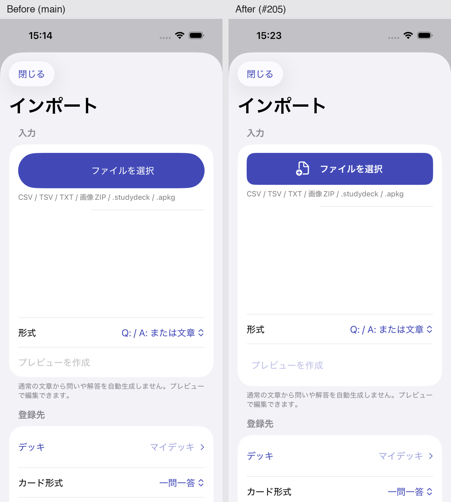
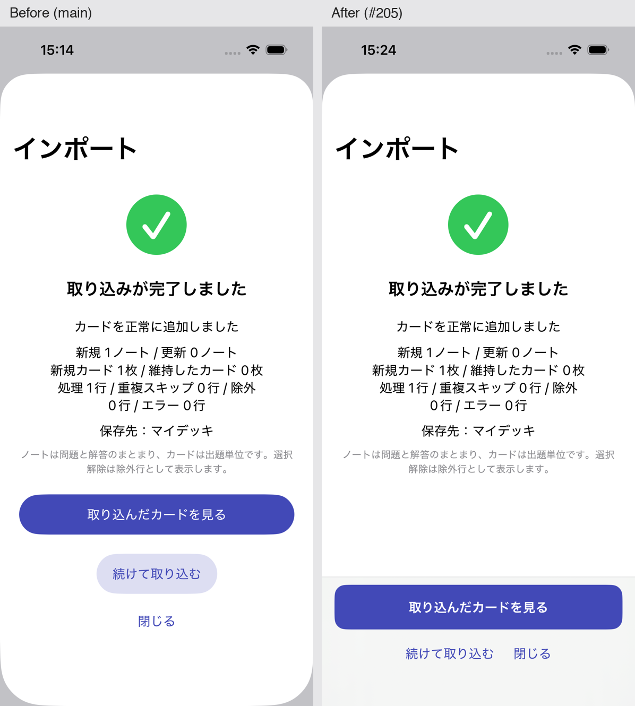

# ボタン・操作UIの基準（Issue #205）

画面の主操作は `PrimaryActionStyle`（最低56pt・十分な横幅）、副操作は `SecondaryActionStyle`（最低44pt・アクセント色のテキスト）を使う。必要な下部操作は `safeAreaInset` に `BottomActionArea` を配置する。既存の評価ボタンの簡潔なButtonStyleを共通化し、色・押下・無効状態の重複を減らした。

標準のtoolbar、List行、Picker、メニュー、swipeActions、危険操作の確認ダイアログはSwiftUI標準を優先する。アイコンの見た目は小さくても通常44×44ptの操作領域を確保し、toolbarには独自フレームを強制しない。危険操作は `.destructive` と既存確認を維持する。

## 棚卸しと適用

| 画面 | 調査結果・対応 |
| --- | --- |
| ホーム | おすすめ・開始・再開は既に56pt。共通スタイルへ移行し、他のモードは標準List行のまま。待機時の完了は副操作44pt。 |
| 学習 | 答え表示は既存の固定下部を維持し共通化。4評価は色を維持して56ptに統一し、以前の追加上下paddingをなくして本文領域を確保。音声再生・停止は副操作44pt。Undo・中断は標準toolbar。既存スワイプや固定領域のシールドは変更しない。 |
| ライブラリ | 空状態の追加を主操作、インポート・条件解除を副操作に統一。階層デッキの展開ラベルは36ptから44ptへ。通常の追加・編集はtoolbar、削除・一括操作は既存確認とListの導線を維持。 |
| カード編集 | 小さな上部保存を56ptの下部固定へ移動。閉じるは標準toolbar、保存して次へは44ptの副操作。保存条件・下書き・確認・再試行処理は同じ。 |
| インポート | ファイル選択・確定に共通スタイル。CSV/画像ZIP/studydeck/APKGの既存確定部品で共通利用。プレビューは副操作。結果確認・再試行・続行・閉じるを完了画面の固定下部に移動。既存の処理中オーバーレイ・全体disabledを維持。 |
| OCR・デッキファイル | OCRのプレビューを下部固定。デッキ取込完了・書出完了も共通の固定操作エリアへ。空結果は再試行を優先。 |
| デッキ管理 | 展開アイコンは既に44pt、選択行・追加・保存・キャンセルは標準List/toolbarが自然なため維持。削除確認は変更しない。 |
| 設定 | 最適化結果適用・復元後ホームへの操作を共通化。計算は44pt副操作。通常の設定は自動反映と標準Form行を維持。リセット・復元確認は変更しない。 |
| 記録 | PR #206の月送り・日付・期間・詳細行は既に44pt基準。標準Pickerと既存操作領域を維持。 |
| セレブレーション | PR #203の下部固定56ptを共通化し、カプセル形と色を維持。記録を見るは44pt副操作。 |

## 段階適用の残り

画像トリミング・マスク編集・並び替え回答の専用操作、一括編集・文字置換・復元ツールの個別実行ボタン、白紙ノートや一部の空状態・復習終了ガイダンスは既存UIを維持した。専用操作の確認フローや学習機能を巻き込む一括書換えは行っていない。新規画面はAGENTS.mdの原則を適用する。

## 検証

- PR #206マージ後のmain `30d20cc` を起点とする独立ブランチ。
- Debugビルド成功。iPhone 15 Pro / iOS 26.5の専用SimulatorとUUID付きUITestStoresだけを利用。
- 代表画面の撮影用一時チェックで、保存のdisabled・56pt・キーボード表示中の保存、答え表示・4評価の56pt、取込確定と完了後続行を確認。撮影チェックはリポジトリに追加しない。
- 既存の長文学習・固定評価・Undoチェック、インポート完了の結果確認・続行・空結果再試行チェックが成功。全テストは実行しない。
- 最初の撮影で、非表示入力欄とキーボードで隠れた入力欄へのタップ手順が失敗。スクロール・キーボードを閉じる手順を補正後に成功。再撮影のRunner終了も単独再実行で解消。
- FSRS・永続化・スキーマ・保存・Undo・取込・削除処理、HapticsServiceは変更しない。本番学習データに触れない。
- 実機・物理触覚・長時間処理や保存失敗の注入は未検証。OCR・デッキファイル完了・設定の変更はビルド確認のみ。既存ProgressViewと二重実行防止を維持。

## UI比較

左がmain、右が変更後。同じiPhone 15 Proの隔離データを使用。

