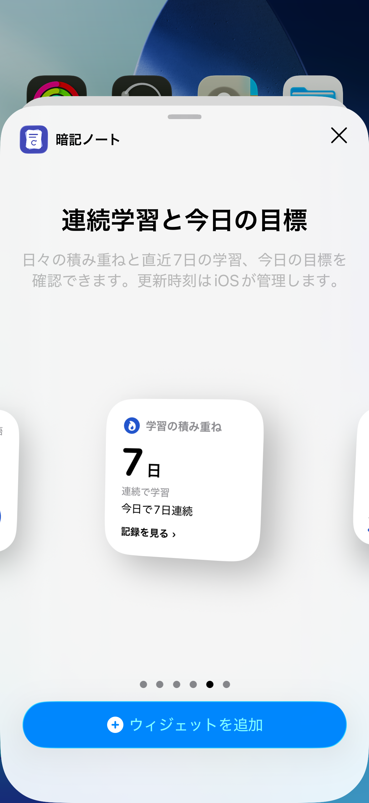
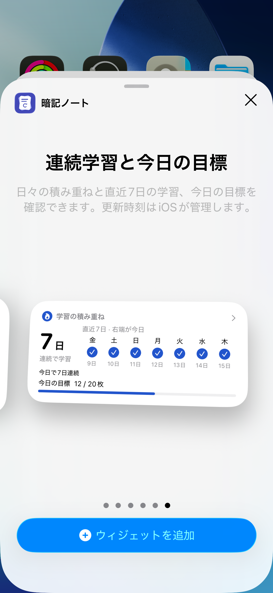
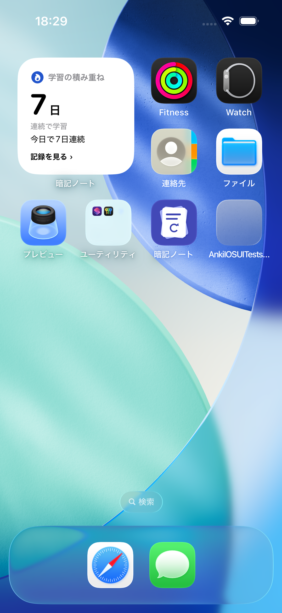
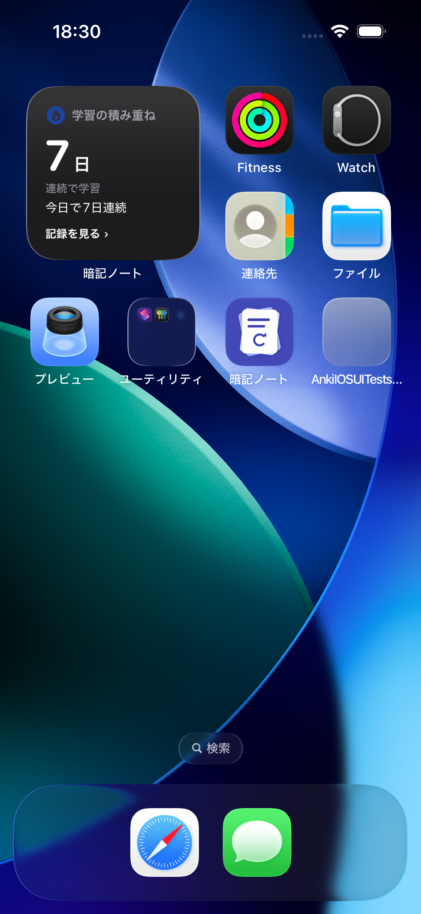

# 連続学習と今日の目標 Widget (#231)

既存の進捗／今日の1枚とは別のWidget。Smallは日数・今日の実施状態・学習または記録への導線、Mediumは直近7日の曜日／日付と実施マーカー、有効な日次目標の進捗を表示する。PrimaryActionとシステム背景を使用。色だけに依存せずチェックと文章で状態を伝える。

## 正本と読み取り

#102の保存済み正式評価（grade 1〜4）だけを全デッキ共通で集計する。問題／答えの閲覧やWidget操作では書き込まない。連続日数は既存Achievementのoccupied-day判定を共用し、日付区切りにはStudyDayを使う。目標は当日ログのユニークCard ID数。停止／削除カードの保存済み履歴も既存実績と同様に残る。

StatisticsReaderの背景Actorで今日の正式履歴と日別の有無（fetchLimit=1）を読み、全ReviewLog取得・FSRSデコードを避ける。連続日数は既存と同じく連続する学習日だけを確認するので、処理量は回答履歴総数ではなく継続日数に依存する。既存Publisherの同一要求抑制・合流・mutationRevision照合を再利用する。日次目標／境界時刻／タイムゾーン／Undo／復元などの更新は既存の共有更新経路を通る。

App Groupのprogress-v1.jsonにoptionalのstreak投影を追加。旧ファイルは読み取れ、Streakデータがないときはアプリでの更新を案内する。atomic書き込み・サイズ上限・ファイル検証を維持。DBスキーマ、FSRS、ReviewLog保存、Achievementイベントの発火条件は変更しない。書き込み失敗は従来の非致命的な共有エラーとして扱い、本体の保存を取り消さない。

## 状態

- 履歴なし：0日、「最初の一歩を、今日から」。
- 昨日まで継続・今日未学習：昨日までの日数、「昨日まで連続」「今日も少し覚えよう」。
- 当日の初評価後：1日／継続日数と今日の学習済み表示。
- 目標達成：チェックと「今日の目標を達成しました」。Mediumは実数／目標、ゲージは目標で上限。
- 3・7・14・30・100日の当日達成：静的な炎バッジと積み重ねの文言。1日目は通常の前向きな案内。
- 一日以上空いたとき：0日、「また今日から始めよう」。過去の履歴は消さない。
- 目標オフ：ゲージを表示しない。7日のマーカーは目標達成ではなく正式評価の有無を示す。

今日学習済みならankistudy://widget/progress（記録タブ）、それ以外はankistudy://widget/home。下部文言も遷移先に一致させる。

## 日跨ぎと更新制限

アプリ側で現在＋7回の学習日境界の値を投影する。今日学習済みなら翌境界で日数を保持し、今日の実施状態・目標進捗をリセット。さらに一日未学習なら0日へ切り替える。今日未学習なら次の境界で0日になる。7日列も同時に移動する。未来の学習を推測しない。

Widget Timelineに境界のエントリーと共有ファイルの期限切れエントリーを含める。既存進捗の期限が期日密度により短縮される場合も、期限後は更新案内になる。タイムゾーンが一致しない場合も数値を出さない。学習・Undo・復元・設定変更・アプリ復帰などでは既存更新要求にStreakのreloadTimelinesを追加。OS管理のため即時更新や正確な境界時刻の描画は保証できない。OSが古い描画を保持することはあるが、期限後／別タイムゾーンで再評価した際に古い達成を今日として再利用しない。

## 検証

Debugビルド成功。関連Unit・Integrationテスト59件成功（既存Widget・統計・キュー・正式評価保存・Undo・目標・復元）。追加確認では東京／ロサンゼルスの投影と既存AchievementProgressの一致、復元前後のWidget投影一致も確認。iPhone 15 Pro / iOS 26.5の専用UIテスト1本成功。Small/Medium・ライト/ダーク・既存Widget両サイズ・記録タブへの実Widgetリンクを確認した。全テストは実行していない。実機の長時間放置・OS更新予算・背景除去／アクセント表示の詳細は未検証。

Small / Mediumのギャラリープレビューとホーム配置（テスト専用データ）：

| Small | Medium |
| --- | --- |
|  |  |

| ホーム・ライト | ホーム・ダーク |
| --- | --- |
|  |  |
