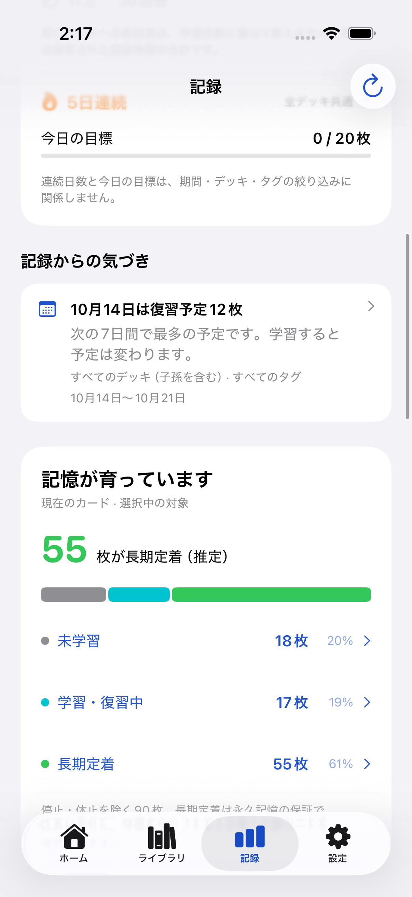
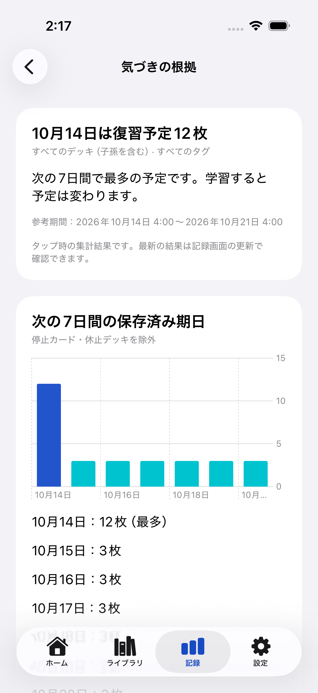

# 記録からの気づき (#105)

StatisticsReaderのactor内で、保存済みデータの値だけから生成する。ネットワーク、乱数、保存処理、触覚・祝福は使わない。記録サマリーの下に最大2件表示し、タップで同じ対象・数値・期間を持つ根拠画面を開く。根拠はタップ時点の集計結果として表示する。

| 型付きルール | 必要な根拠・閾値 | 対象・期間 | 到達先 |
|---|---|---|---|
| volume | 前の期間の開始日以前に記録が存在し、直近のユニークCard ID数が前の期間より多い | 選択中のデッキ（子孫含む）・タグAND。7/30/90日の完了した学習日を、その前の同じ日数と比較。今日は除外。全期間では非表示 | 比較棒グラフ、両期間の枚数と開始・終了（終了は未満） |
| forecastPeak | 次の7学習日に保存済み期日が1枚以上 | 選択中の対象。停止カード・休止デッキを除外、期限超過は今日に含む。実績期間の選択とは独立 | 同じ7日分のグラフ・各日の枚数。最多が同数なら最初の日 |
| retention | Review状態からの対象試行が20以上、対象の現在の設定目標が1種類 | 選択中の対象・7/30/90日（今日を含む）。各カード・学習日で最初のReview回答。Hard/Good/Easy成功数÷Againを含む対象試行数。全期間では非表示 | 実測と設定目標のグラフ、分子・分母・カード数・定義 |
| streak | 今日の保存済み回答があり、連続学習日数が3/7/14/30/100日のいずれか | 全デッキ共通。デッキ・タグ・実績期間から独立し明記。節目の当日のみ | 連続期間・今日のユニーク枚数と、既存の日別実績・達成履歴 |

復習予定→連続学習→学習量→保持率の順で候補を評価する。実用情報（復習予定/保持率）と成果（連続学習/学習量）は各1件まで。同じルールや同じ役割を重複表示しない。候補がない場合はセクションごと非表示。前期間が0枚でも差分の枚数だけを表示し、割合は計算しない。継続途切れ、少数試行、複数設定目標、増加なしについて否定的なカードを作らない。

過去の定着状態を再現するスナップショットがないため「長期定着が増えた」は生成しない。初期版では日次目標の節目と苦手カードの気づきは未採用。原因・記憶力・生活習慣の推測や負荷軽減の断定は行わない。

学習日は設定した開始時刻とCalendarのタイムゾーンで区切り、固定秒数で日数を引かない。欠測の学習量比較は抑止し、観測開始後の回答なしの日は0として扱う。期間内でカードを重複計上せず、2期間で同じCard IDを扱う。Undoされたログは消えているため含まれない。削除履歴は既存統計と同じ契約で、所属が不明なログは全デッキ集計には残り、デッキ/タグ絞り込みからは除外される。学習量は現存する記録の比較であり、削除前の実績復元ではない。

期間選択は生成済みの期間別結果を切り替える。デッキ/タグ・保存/Undo・削除・復元は既存の世代番号とmutationRevisionで非同期集計を更新する。日境界/タイムゾーン変化は記録タブの既存監視と再アクティブ化で再集計する。古いタスク結果は表示しない。UIは標準NavigationLink、Chart、意味的フォントとシステム背景色を使用し、文字を切り詰めずに折り返す。

## 代表画面

