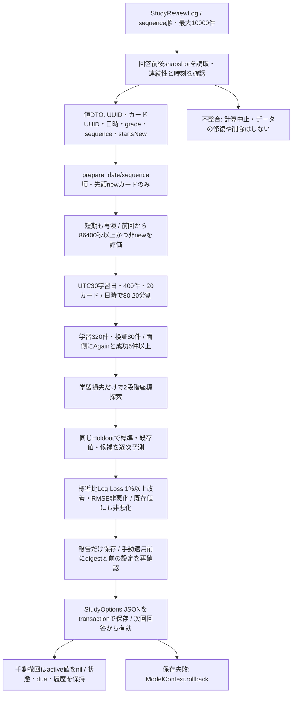

# FSRS個人最適化監査 — Issue #189

検証日: 2026-10-13〜14 (JST)。開始時の最新main `b361df28ab3c6fd7ff4c2bb937be1f40ee578ef0` から独立ブランチで実施。

## 結論

**標準設定の維持を推奨する。独自座標探索は置換しない。** 合成3条件×3seedで候補の学習損失は改善するが、検証Log Lossが悪化するケースもある。採用条件を満たした2/9ケースを含め、候補−標準のLog Loss差のカード単位bootstrap 95%区間は全9ケースでゼロを含む。個人データでの優越性や学習成果改善を示す証拠ではない。

最小修正は途中ログの欠落・同一カードの時刻逆転・重複sequenceの拒否。従来は「先頭がnew」を連続履歴の根拠としていたため、途中欠落を見落としていた。21パラメータ、探索・採用閾値、依存revision、永続化schema、旧報告のCodable形式は維持する。適用は引き続き明示操作で、自動適用は導入しない。

## 現在のデータフロー



- `LibraryRepository.optimizationReviews()` は回答前snapshotのstateがnewかを取得する。修正後はsequence順で前の回答後snapshotと次の回答前snapshotが一致するかも確認する。明示的なnewリセットは許可。途中欠落・同カードの時刻逆転は全計算を中止する。
- 比較は保存されたCard JSONを内包する`SchedulerSnapshot`の等価性。通常保存・バックアップは元payloadを保持する。同じ意味でもCard JSONを外部で再エンコードした場合は保守的に拒否することがある。書換えて修復しない。残った隣接ログの確認であり、残っていない末尾ログまで検出するものではない。
- 初回履歴のないカードは全系列を除外。先頭不明系列の途中にnewがあってもsuffixだけは採用しない。先頭newの系列では後のnewで再初期化する。
- 同時刻はsequenceで再演し、split日時と等しい全イベントを学習側に置く。厳密な80/20件数比とは限らない。重複ID/sequenceを拒否。sequenceの数値の飛びだけでは欠損判定しない（別カード・Undoによる飛びを許容）。
- 日数はUTC暦日、評価は前回から経過24時間以上。ローカル日付が変わるだけでは対象にならない。短期回答は損失に数えず、次の予測状態には反映する。
- `evaluate()` は各profileでnewから全系列を再演。対象回答の`before`から予測した**後**に実gradeで次状態へ進める。検証中の過去回答を次の検証予測に使うのは逐次運用と同じで、候補探索への混入とは異なる。
- `run()` は標準値から開始し、21座標×step=0.2,0.1×負/正方向を1回ずつ探索（最大84提案）。範囲は標準値50〜150%とboundsの交差。学習Log Lossに標準からの正規化二乗距離×0.0001を加える。収束まで反復せず、既存個人値を初期値にも使わない。
- 保持率・既存dueは再演の入力でなく、実日時・回答を固定して比較する。再演schedulerは保持率0.9・short-term有効・fuzz無効。RMSEは個々の回答のBrier scoreの平方根。
- 報告保存・適用前に履歴SHA-256、raw件数、日数、split、検証数、前active値一致を確認。`transaction`のsave成功時だけ確定、失敗時rollback。適用・撤回はオプションだけ更新し、過去のUUID・snapshot・due・ReviewLog・下書きを変更しない。
- `FSRSOptimizationView` はutility Taskで計算。離脱・非active・キャンセルで取消し、完了待ち後にも取消確認して報告保存を抑止。64イベントごとに取消と60秒期限を確認。履歴不足・非採用・計算/保存失敗は既存の別表示を使用する。

## 公式実装との比較

Context7でfsrs-rs文書を取得した後、2026-10-13のGitHub公式ソースをrevision固定で確認した。

| 対象 | 固定版・参照 | 比較結果 |
| --- | --- | --- |
| 本アプリSwift FSRS | [`4fbaf20184d62f82a9f44f343337c61a2c5483e9`](https://github.com/open-spaced-repetition/swift-fsrs/tree/4fbaf20184d62f82a9f44f343337c61a2c5483e9) | 21値でFSRS-6を明示指定。snapshot schema=1、algorithmVersion=FSRS-6。learningStepsを含む全Cardを保存。依存更新なし。 |
| 現行fsrs-rs | version **6.6.2**, [`0a5737406a0c5c7a5259b144738cbe4a0b649d76`](https://github.com/open-spaced-repetition/fsrs-rs/tree/0a5737406a0c5c7a5259b144738cbe4a0b649d76) | FSRS-6の21標準値はSwiftと一致。FSRS-7も含むため、package版とモデル版を同一視しない。 |
| 現行Anki main | [`b15d4c71eadd3c4a74afaba74f93f4b3f70ac97c`](https://github.com/ankitects/anki/tree/b15d4c71eadd3c4a74afaba74f93f4b3f70ac97c)、[Cargo.lock](https://github.com/ankitects/anki/blob/b15d4c71eadd3c4a74afaba74f93f4b3f70ac97c/Cargo.lock) のfsrs=6.6.2 | latest release tag取得結果は26.09.3。コード比較対象はmainでありreleaseと同一とは断定しない。 |

FSRS-6のw0〜w3は初回評価別stability、w4〜w7はdifficulty更新、w8〜w10は成功時stability増加、w11〜w14は忘却時更新、w15〜w16はHard/Easy補正、w17〜w19は短期stability、w20は忘却曲線decay。標準値の一致はoptimizerや再演の同等性を意味しない。

- 公式[training.rs](https://github.com/open-spaced-repetition/fsrs-rs/blob/0a5737406a0c5c7a5259b144738cbe4a0b649d76/src/training.rs) はHostAdam、cosine learning rate、batch、複数epoch。[training_v6.rs](https://github.com/open-spaced-repetition/fsrs-rs/blob/0a5737406a0c5c7a5259b144738cbe4a0b649d76/src/training_v6.rs) のparameter別stddevを使うL2は独自penaltyと異なる。Ankiは8epoch指定。過去のBurnベースという説明を現行ソースにそのまま当てはめない。
- 公式[parameter_clipper_v6.rs](https://github.com/open-spaced-repetition/fsrs-rs/blob/0a5737406a0c5c7a5259b144738cbe4a0b649d76/src/parameter_clipper_v6.rs) は再学習stepsによりw17/w18上限を変更。本アプリは固定boundsと標準±50%。探索空間・初期化・最適解は同じではない。
- Ankiの[params.rs](https://github.com/ankitects/anki/blob/b15d4c71eadd3c4a74afaba74f93f4b3f70ac97c/rslib/src/scheduler/fsrs/params.rs) は学習日境界のdelta_tと過去prefixを含むFSRSItemを作る。legacy evaluateと新しい5分割時系列評価APIがある。最適化時の既存値比較・health checkも単一Holdout閾値とは異なる。
- 公式[inference.rs](https://github.com/open-spaced-repetition/fsrs-rs/blob/0a5737406a0c5c7a5259b144738cbe4a0b649d76/src/inference.rs) の`rmse_bins`は履歴特性bin内の平均pと実測率の差。本アプリの非bin RMSE・この監査の確率帯ECEとも異なり、AnkiのRMSEと直接比較しない。
- pinned Swiftの[FSRSHelper.swift](https://github.com/open-spaced-repetition/swift-fsrs/blob/4fbaf20184d62f82a9f44f343337c61a2c5483e9/Sources/FSRS/Helper/FSRSHelper.swift) は状態遷移でUTC暦日差を使い、[FSRS.swift](https://github.com/open-spaced-repetition/swift-fsrs/blob/4fbaf20184d62f82a9f44f343337c61a2c5483e9/Sources/FSRS/Algorithm/FSRS.swift) のretrievabilityは経過秒/86400のfloor。日境界付近ではdeltaが違う。監査はアプリの予測APIを使うのでAnki時刻仕様への一致は示さない。snapshot解釈に関わる依存変更は本PRに含めない。
- [Anki公式Manual](https://docs.ankiweb.net/manual/deck-options#fsrs-parameters) の最適化・評価・変更時再スケジュールは別操作。本アプリは過去dueを変更しない。Anki optimizerの数値性能そのものは今回は実行比較していない。

## 比較データと評価方法

ユーザーの端末・バックアップ・個人パラメータを読み出していない。実学習データの書換え・外部送信はない。「既存値」は標準w2×0.8、w8×0.9とした**合成baseline**であり本人の設定ではない。

`FSRSOptimizationAuditTests` は30カード×40回答＋初回10分後の短期回答を生成。1230 raw件、1170評価件、UTC40学習日。全profileで同じ936学習・234検証回答を使い、ID列一致をassertする。日時はday²×2日＋カード別90秒＋日別0/2/4時間offset。約3042日を圧縮生成する長期stress fixtureで、実際の人の年単位の変化を再現するものではない。

固定LCG（seed=189,190,191）のBernoulli想起。成功時はHard60%・Good35%・Easy5%。初回は成功、10分後はGood。生成器もpinned Swiftの予測・遷移を使うため、同モデルfamilyを有利にする限界がある。

| 条件 | 生成側設定 |
| --- | --- |
| 標準生成 | 標準FSRS-6で全系列 |
| 個人生成 | w0〜w3×0.6、w8×0.7（探索域外も含む） |
| 後半変化 | 個人からday32以降に標準へ変更、状態は保持。splitはday32の6件目で変更後の一部も学習側に入る。未来回答の混入でなく記録時刻分割の結果。 |

候補は本番`run()`そのもの。観測callbackで**本番evaluateの回答前確率**を収集し、テスト側で校正・CIを計算する。報告の永続化形式には追加しない。

Log Lossは自然対数、RMSE=√mean((p−y)²)、成功=grade≠Again。ECEは固定幅5確率帯のΣ(n_bin/N)×|平均p−成功率|。固定回答・日時での予測比較であり、候補適用時のdue・将来の学習成果の実験ではない。

## 予測精度と校正

LLとRMSEは学習→検証。成功率・平均p・ECEは検証値。全行936/234回答・30カード。

| 条件 | seed | profile | Log Loss 学習→検証 | RMSE 学習→検証 | 成功率 | 平均p | ECE |
| --- | --- | --- | --- | --- | --- | --- | --- |
| 標準生成 | 189 | 標準 | 0.3429 → 0.4219 | 0.3271 → 0.3769 | 0.795 | 0.777 | 0.0466 |
| 標準生成 | 189 | 既存値Fixture | 0.3424 → 0.4215 | 0.3268 → 0.3765 | 0.795 | 0.766 | 0.0521 |
| 標準生成 | 189 | 候補 | 0.3403 → 0.4164 | 0.3257 → 0.3732 | 0.795 | 0.776 | 0.0383 |
| 標準生成 | 190 | 標準 | 0.3220 → 0.4188 | 0.3108 → 0.3727 | 0.795 | 0.772 | 0.0253 |
| 標準生成 | 190 | 既存値Fixture | 0.3226 → 0.4211 | 0.3111 → 0.3738 | 0.795 | 0.760 | 0.0353 |
| 標準生成 | 190 | 候補 | 0.3190 → 0.4154 | 0.3099 → 0.3706 | 0.795 | 0.780 | 0.0145 |
| 標準生成 | 191 | 標準 | 0.3150 → 0.3385 | 0.3098 → 0.3252 | 0.833 | 0.829 | 0.0204 |
| 標準生成 | 191 | 既存値Fixture | 0.3168 → 0.3392 | 0.3106 → 0.3258 | 0.833 | 0.819 | 0.0371 |
| 標準生成 | 191 | 候補 | 0.3128 → 0.3411 | 0.3089 → 0.3263 | 0.833 | 0.837 | 0.0299 |
| 個人生成 | 189 | 標準 | 0.5166 → 0.5760 | 0.4119 → 0.4514 | 0.662 | 0.670 | 0.0780 |
| 個人生成 | 189 | 既存値Fixture | 0.5107 → 0.5720 | 0.4104 → 0.4497 | 0.662 | 0.657 | 0.0545 |
| 個人生成 | 189 | 候補 | 0.4997 → 0.5659 | 0.4067 → 0.4448 | 0.662 | 0.630 | 0.0566 |
| 個人生成 | 190 | 標準 | 0.4634 → 0.5410 | 0.3884 → 0.4309 | 0.662 | 0.691 | 0.0367 |
| 個人生成 | 190 | 既存値Fixture | 0.4600 → 0.5400 | 0.3874 → 0.4307 | 0.662 | 0.678 | 0.0204 |
| 個人生成 | 190 | 候補 | 0.4570 → 0.5449 | 0.3862 → 0.4332 | 0.662 | 0.657 | 0.0287 |
| 個人生成 | 191 | 標準 | 0.4491 → 0.5396 | 0.3838 → 0.4308 | 0.675 | 0.693 | 0.0404 |
| 個人生成 | 191 | 既存値Fixture | 0.4459 → 0.5358 | 0.3826 → 0.4295 | 0.675 | 0.682 | 0.0561 |
| 個人生成 | 191 | 候補 | 0.4429 → 0.5377 | 0.3809 → 0.4314 | 0.675 | 0.653 | 0.0983 |
| 後半変化 | 189 | 標準 | 0.5166 → 0.5280 | 0.4119 → 0.4284 | 0.697 | 0.685 | 0.0568 |
| 後半変化 | 189 | 既存値Fixture | 0.5107 → 0.5274 | 0.4104 → 0.4278 | 0.697 | 0.672 | 0.0326 |
| 後半変化 | 189 | 候補 | 0.4997 → 0.5339 | 0.4067 → 0.4278 | 0.697 | 0.640 | 0.0568 |
| 後半変化 | 190 | 標準 | 0.4634 → 0.5304 | 0.3884 → 0.4254 | 0.701 | 0.701 | 0.0181 |
| 後半変化 | 190 | 既存値Fixture | 0.4600 → 0.5304 | 0.3874 → 0.4258 | 0.701 | 0.688 | 0.0299 |
| 後半変化 | 190 | 候補 | 0.4570 → 0.5367 | 0.3862 → 0.4289 | 0.701 | 0.666 | 0.0458 |
| 後半変化 | 191 | 標準 | 0.4491 → 0.5157 | 0.3838 → 0.4200 | 0.701 | 0.705 | 0.0466 |
| 後半変化 | 191 | 既存値Fixture | 0.4459 → 0.5131 | 0.3826 → 0.4191 | 0.701 | 0.693 | 0.0728 |
| 後半変化 | 191 | 候補 | 0.4429 → 0.5176 | 0.3809 → 0.4220 | 0.701 | 0.665 | 0.1266 |

### 不確実性

同一回答での候補−baselineのLL差を計算。30カードをclusterとして復元抽出、1000回、seed=189、2.5/97.5 percentile。カード内反復を独立標本とは扱わない。マイナスが候補優位。234回答の小標本であり、9条件の多重比較補正や実ユーザー間の汎化は評価していない。

| 条件 | seed | 現行閾値で採用 | 候補−標準LL 95%区間 | 候補−既存値LL 95%区間 |
| --- | --- | --- | --- | --- |
| 標準生成 | 189 | 可 | [-0.0142, 0.0035] | [-0.0105, 0.0011] |
| 標準生成 | 190 | 不可 | [-0.0098, 0.0036] | [-0.0147, 0.0037] |
| 標準生成 | 191 | 不可 | [-0.0037, 0.0091] | [-0.0086, 0.0125] |
| 個人生成 | 189 | 可 | [-0.0268, 0.0077] | [-0.0198, 0.0087] |
| 個人生成 | 190 | 不可 | [-0.0103, 0.0187] | [-0.0041, 0.0144] |
| 個人生成 | 191 | 不可 | [-0.0128, 0.0084] | [-0.0062, 0.0097] |
| 後半変化 | 189 | 不可 | [-0.0156, 0.0328] | [-0.0114, 0.0286] |
| 後半変化 | 190 | 不可 | [-0.0082, 0.0208] | [-0.0028, 0.0160] |
| 後半変化 | 191 | 不可 | [-0.0095, 0.0125] | [-0.0035, 0.0119] |

標準生成seed189は1.30%、個人生成seed189は1.76%の検証LL改善で採用可だが、両方CIはゼロを含む。学習LLは全9ケース改善、検証LLは5ケース悪化。非採用時に設定維持する判定は機能するが、採用可を統計的確証と扱うべきではない。

### 確率帯別校正（seed189）

cellは`件数 / 平均p / 実測成功率`。同じ検証回答でもprofileによって帯への所属が変わる。空帯は「—」。1〜13件程度の帯は特に不安定で、ECEだけで優位性を判断しない。

| 条件 | 確率帯 | 標準 | 既存値Fixture | 候補 |
| --- | --- | --- | --- | --- |
| 標準生成 | [0.0, 0.2) | — | — | — |
| 標準生成 | [0.2, 0.4) | 1 / 0.388 / 1.000 | 1 / 0.386 / 1.000 | — |
| 標準生成 | [0.4, 0.6) | 61 / 0.509 / 0.623 | 68 / 0.512 / 0.632 | 60 / 0.540 / 0.633 |
| 標準生成 | [0.6, 0.8) | 44 / 0.678 / 0.614 | 42 / 0.683 / 0.619 | 52 / 0.679 / 0.635 |
| 標準生成 | [0.8, 1.0] | 128 / 0.942 / 0.938 | 123 / 0.938 / 0.943 | 122 / 0.934 / 0.943 |
| 個人生成 | [0.0, 0.2) | — | — | — |
| 個人生成 | [0.2, 0.4) | 8 / 0.372 / 0.250 | 9 / 0.373 / 0.333 | 13 / 0.371 / 0.385 |
| 個人生成 | [0.4, 0.6) | 100 / 0.507 / 0.590 | 110 / 0.509 / 0.573 | 118 / 0.526 / 0.585 |
| 個人生成 | [0.6, 0.8) | 56 / 0.681 / 0.554 | 50 / 0.687 / 0.600 | 56 / 0.676 / 0.625 |
| 個人生成 | [0.8, 1.0] | 70 / 0.926 / 0.900 | 65 / 0.924 / 0.908 | 47 / 0.909 / 0.979 |
| 後半変化 | [0.0, 0.2) | — | — | — |
| 後半変化 | [0.2, 0.4) | 8 / 0.372 / 0.250 | 9 / 0.373 / 0.333 | 13 / 0.371 / 0.385 |
| 後半変化 | [0.4, 0.6) | 92 / 0.505 / 0.587 | 102 / 0.508 / 0.569 | 110 / 0.524 / 0.582 |
| 後半変化 | [0.6, 0.8) | 52 / 0.679 / 0.596 | 46 / 0.686 / 0.674 | 60 / 0.687 / 0.750 |
| 後半変化 | [0.8, 1.0] | 82 / 0.920 / 0.927 | 77 / 0.915 / 0.922 | 51 / 0.902 / 0.961 |

## 過学習・情報漏洩・安全性

| 項目 | 検証と結論 |
| --- | --- |
| 回答後状態 | 最初のHoldoutのgradeを反転しても同じ回答前p、yだけ変わる。観測は`engine.next`より前。 |
| 未来回答 | 全Holdoutのgradeを反転しても候補21値と学習metricsは不変。学習evaluateはsplitを超える前に停止。 |
| split選定 | 対象件数・日時・両側grade分布でsplit/実行可否を決める。Holdoutラベルを候補損失には使わないが、分布条件による母集団選択はある。未来scheduleも固定観測値でprospective試験ではない。 |
| 過学習 | 学習LL改善と検証LL悪化の併存。L2・狭い探索域は保証にならない。 |
| 再計算の選択バイアス | 同じHoldoutで採用判断を反復可能。既存profileの過去の学習集合も独立とは保証されない。未使用の将来期間での再評価が必要。 |
| 不足・極端grade | 399件・19カード・29日・先頭欠落・全Again/全Goodを拒否。400件/20カード/30日・320/80分割は通過。最低5件ずつは統計的十分性の根拠でない。 |
| 重複・欠損・時刻 | 重複ID/sequenceを拒否。snapshot付き中間ログ削除・同カード時刻逆転の追加integrationで拒否、前後BackupData一致。時計を自動修正しない。 |
| 日付・短期 | 24時間ちょうどと1秒前、同時刻split、逆順入力、60秒平行移動を確認。UTC/経過秒で端末timezone/DSTに非依存（source確認）。全timezoneを操作するUIテストは未実施。 |
| 設定変更 | 保存・適用は前active値一致を要求。連続適用はstaleで拒否、撤回後再適用可。変更3回でもcards/logs/sessions不変。既存状態を新profileで作り直さない。 |
| Undo | grade後UndoでfsrsBefore復元・最新ログ削除。digestが変われば旧報告は適用不可。完全バックアップ復元後grade/Undo、UUID/snapshot保持を既存関連テストで確認。 |
| 保存失敗 | 報告save失敗のBackupData全体一致を追加確認。適用/撤回save失敗のrollback・active値/変更履歴保持も既存関連テストで確認。 |
| 取消・期限 | Task取消・期限超過を既存関連unitで確認。Viewの完了待ち後取消確認はsource確認。実機での遅延・電力は未測定。 |
| バックアップ互換 | 最適化無し旧StudyOptions JSONは標準。旧coordinate-v1報告・active値の完全バックアップ往復と復元後Undoを確認。schema/revision/methodを維持し旧reportを無条件無効化しない。新連続性検証を通らない履歴での再適用は不可。 |
| 修正の影響 | 最適化入力を保守的に拒否するだけ。active値を勝手に解除せず、学習データ・due・UUIDに書込みなし。 |

## 性能・テスト・再現

3,000カード×3回答=9,000 rawイベント（評価6,000、検証1,200）で本番探索・3profile評価は**10.801秒**、60秒制限内（初回10.714秒）。Debug/iPhone17 Proシミュレーター、iOS26.5、単発測定。

`getrusage(RUSAGE_SELF).ru_maxrss`のテストhost全体high-water markは計算前382.61 MiB→後393.81 MiB（増分11.20 MiB）。専用peak allocationではなくSwiftUI・XCTest等も含む。入力生成後の計測で実DBの全snapshot抽出コストは含まない。著しい問題の兆候はないが、実機peakメモリ/電力の保証ではない。実機・Instruments・全テスト・UI自動テストは依頼に従い省略。

変更関連**25テストが最終的に全件成功**（ReviewScheduler5、既存FSRSOptimization11、監査5、Repository最適化4）。Debugアプリ・テストhost・依存ビルド成功。初回合成FixtureはHoldoutのAgain不足で拒否されたため、回答結果を後から改変せず、時刻設計を長間隔・成功gradeをHard中心に変更。追加境界テストの変数名重複によるビルド失敗も修正済み。実履歴は使用していない。

完全ログ/xcresultは`/tmp/fsrs189-tests.*`（既存・integration成功）、`/tmp/fsrs189-audit-retry.*`（監査4件成功）、`/tmp/fsrs189-boundaries-retry.*`（境界2件成功）。境界1件は重複実行なのでdistinct total25。Gitにログを含めない。本表は成功runのstdout `FSRS_AUDIT|`（精度）、`FSRS_CAL|`（校正）、`FSRS_DELTA|`（CI）、`FSRS_LOAD|`（性能）から生成。個人履歴・UUIDは出力しない。

このブランチで次の関連テストのみ実行すれば再現できる。destinationは利用可能なシミュレーターに合わせる。

```sh
xcodebuild test -project AnkiIOS.xcodeproj -scheme AnkiIOS \
  -configuration Debug -destination 'platform=iOS Simulator,name=iPhone 17 Pro,OS=26.5' \
  -derivedDataPath /tmp/fsrs189-reproduce \
  -only-testing:AnkiIOSTests/ReviewSchedulerTests \
  -only-testing:AnkiIOSTests/FSRSOptimizationTests \
  -only-testing:AnkiIOSTests/FSRSOptimizationAuditTests \
  -only-testing:AnkiIOSTests/LibraryRepositoryTests/testOptimizationApplyResetBackupAndUndoKeepAllExistingState \
  -only-testing:AnkiIOSTests/LibraryRepositoryTests/testOptimizationRejectsStaleOrWorseAndRollsBackSaveFailure \
  -only-testing:AnkiIOSTests/LibraryRepositoryTests/testOptimizationMissingMiddleLogAndClockReversalFailWithoutWrites \
  -only-testing:AnkiIOSTests/LibraryRepositoryTests/testOptimizationFailedReportSaveAndRepeatedApplyPreserveData \
  -resultBundlePath /tmp/fsrs189-reproduce.xcresult > /tmp/fsrs189-reproduce.log 2>&1
```

metricsの同一母集団・回答前予測・未来変更不変性・境界・保全をassert。時間/RSSや「候補が必ず勝つ」をgolden値にはしない。

## 残る課題と判断

- 本人の本当の既存値対候補は未検証。将来必要なら端末内のみで読み取り評価し、公開成果物は集合指標のみとする。
- 234回答/30カード、Holdout再利用、長期変化、同family生成、狭い探索域、短期回答を評価しない点が限界。標準を上回るとは結論できない。
- 統計的採用閾値や5分割評価への置換は今回は行わない。必要性が示された時点で、未使用の将来Holdout・複数期間・cluster CIを比較方法にした別Issueを提案する。既存個人値/過去dueを自動再計算しない移行方針を維持する。
- UTC暦日遷移と経過24h予測の差は依存更新/時刻仕様の別検討候補。変更前に同履歴・境界日時でprediction/transition parityとsnapshot/バックアップ互換を検証する。大規模optimizer置換の必要性は示されていないので新optimizer Issueは起票していない。
- 実端末負荷・取消遅延は未測定。1万件・60秒・取消を維持する。

独立Draft PRでレビュー可能な状態に留め、自動マージ・Issue Closeは行わない。
