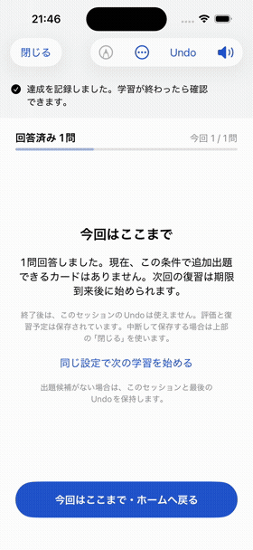
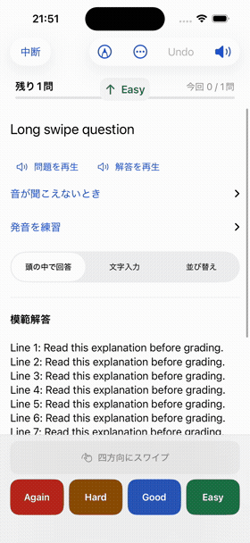

# Issue #214 操作比較

iPhone 15 Pro Simulator（iOS 26.5）、変更前は main `475edbd`。

GIFは長文ハンドルの上方向評価とUndo、短文の左右評価とUndo、斜めの不成立操作の順。短文評価は変更前後とも `(±130, 45)pt` の斜め入力。変更後は見た目が水平だけに制限される。

| 変更前 | 変更後 |
| --- | --- |
|  |  |

Debugビルド、スワイプ関連単体7件、Undo/保存失敗の結合2件、短文/長文の既存UI操作2件を確認。UI操作は4方向評価、短距離・斜め・長押しの不成立、長文縦スクロール、固定ハンドル、評価ボタン除外、Undo後の回答数を含む。

触覚の実機での感触、VoiceOver実読み上げは未確認。Reduce Motion/アニメーションOFFは既存の抑止分岐をコードで確認（実操作未確認）。FSRS・永続化・スキーマは変更していない。
