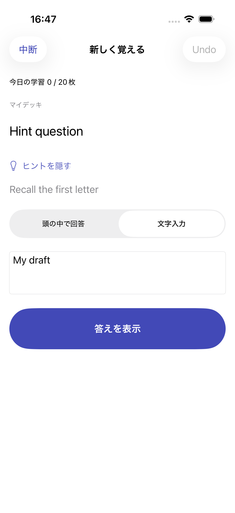
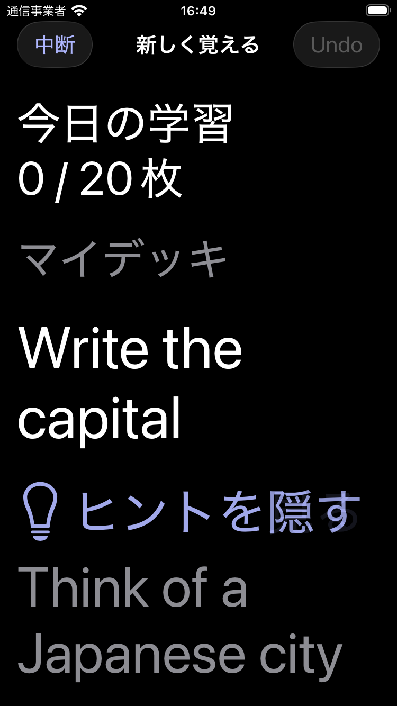

# Issue #47: 任意の学習ヒント

## 実装

- Note共通のOptional `hint`を既存contentPayloadに保存し、4形式の登録・編集・下書き・プレビュー・完全バックアップで保持する。SwiftDataとバックアップのスキーマは変更しない。
- 学習とプレビューの解答前だけ、44pt以上の標準Buttonで開閉する。空欄と逆向きbasicには表示しない。カード切替・答え表示・Undo・中断再開で閉じる。開閉はSwiftUIのローカル状態のみで、回答下書き・FSRS・時間計測を変更しない。
- ヒントのみの編集はカードUUID・FSRS・due・履歴・新規枠と進行中セッションを保持する。旧schemaVersion 1の省略Optionalにも既定値を適用して比較する。
- CSV/TSVは任意列の手動指定と`hint`/`ヒント`ヘッダーの自動判定に対応する。列なしは保持、明示空欄は消去。プレビューで編集・変更取消と更新挙動の確認ができる。重複更新で反転設定や画像も保持する。

## 検証対象

- ヒントキーのない旧TextContent・NoteInput、複数行ヒントのCodable往復。
- basic/written、逆向きbasic、複数cloze（従来の`::ヒント`併存）、複数画像マスクの共有・抑制・安定variantKey。
- ヒント編集・削除、旧contentPayloadの編集、編集下書き、CSV/TSVの列なし・値あり・明示空欄・重複更新でUUID/FSRS/due/ReviewLog/日次枠を維持。
- ヒント付きバックアップの完全復元と、ヒントキーを除いた旧バックアップの復元、編集下書きの保持。
- 初期非表示・開閉・プレビュー、typing下書き、プロセス再起動・中断再開・Undo・次カード、通常の採点とスワイプ。
- ライト、ダーク、最大Dynamic Type、Reduce Motion、アクセシビリティ要素・説明の監査、小型iPhone。

自動監査はVoiceOverで利用される要素・説明を検証する。実機のVoiceOver音声と触覚は未検証。

## 最終結果（2026-10-10）

- iPhone 17 Pro / iOS 26.5 Simulator：単体・結合83件のうち82件成功、既存の実機通知診断1件スキップ。関連UI7件成功。最新実行結果をまとめたユニーク90件で成功89・失敗0・スキップ1。
- iPhone SE第3世代 / iOS 26.5 Simulator：ダーク・最大Dynamic Type・Reduce Motion・アクセシビリティ監査、4形式・逆向き例外・カード切替の追加2件成功。
- 画像マスクはヒントを開いても遮蔽を保持することをスクリーンショットで確認。ライトのtyping下書きと、小型画面の最大文字サイズを視覚確認した。
- 集計は[test-summary.json](test-summary.json)。Xcodeの一時結果は`/private/tmp/anki-issue47-final.xcresult`（全単体・結合＋関連UI）、`anki-issue47-recheck.xcresult`（操作修正後の最大文字サイズ）、`anki-issue47-csv-final.xcresult`（最終CSV編集・保存）、`anki-issue47-small.xcresult`（小型追加2件）。一時結果は永続保管を保証しない。集計は各テストの最新結果を使用する。

再現はScheme `AnkiIOS`をiOS 26.5のiPhoneシミュレーターでテストする。単体・結合は`AnkiIOSTests`全件、UIは集計JSONに記載した`AnkiIOSUITests`の7件を指定する。小型画面は同じQualityUITestsの最大文字サイズテストとStudyUITestsの4形式テストをiPhone SEで実行する。UIテストは独立したUUIDの保存領域を使い、通常データを変更しない。

