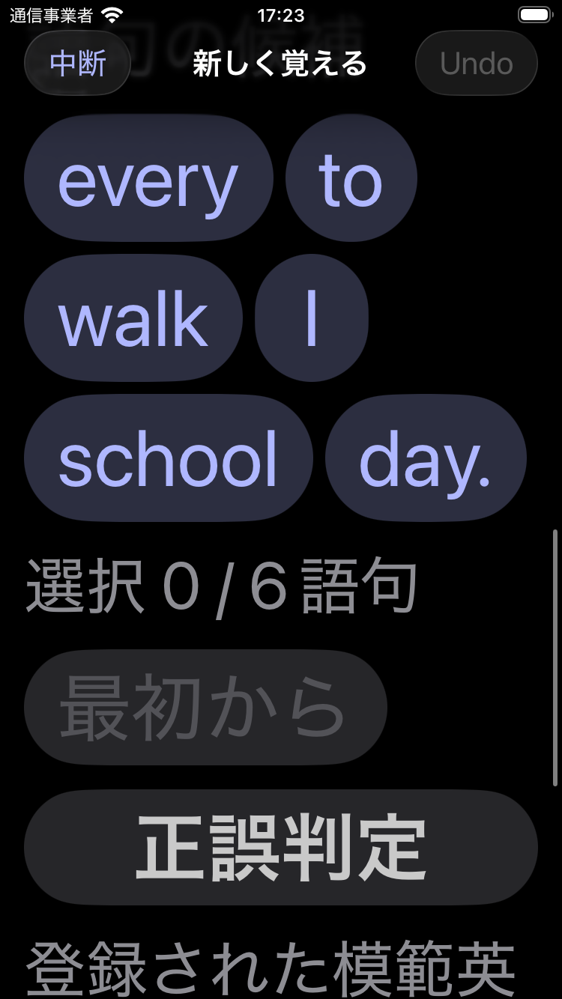
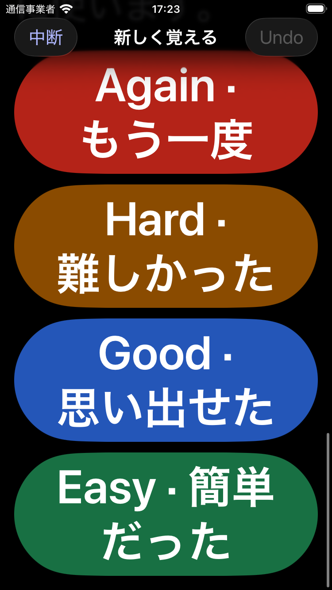
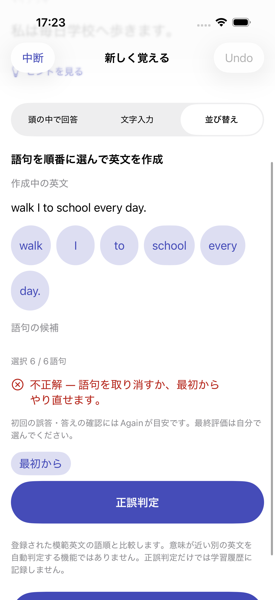

# Issue #49: 英文並び替え回答

## 実装と互換性

- basic / writtenの同じCardを回答方式orderingで出題。空白分割、安定ID、重複語の交換、大文字小文字・両端句読点の正規化。初期候補が正解順にならないことを保証する。原文は保持する。
- チップ選択・取消・リセット、未完成時の判定無効、不正解の再挑戦、正解または答え表示後の4段階評価。初回誤答と答え確認にはAgainを案内する。最終評価は利用者が選び、判定自体はFSRS・ReviewLogを変更しない。
- 純粋な分割・判定・操作状態をUI/FSRSから分離。意味に基づく別解判定や外部通信は行わない。
- SwiftData V4はOrderingDraftRecordだけを追加。既存モデル・UUID・FSRS・履歴を維持しV3から軽量移行する。選択、候補順、初回正誤を中断・再起動・バックアップで保持する。Undo・カード切替は新しい下書き、ヒントだけの編集は既存下書きを保持する。
- 完全バックアップの任意orderingDraftsキーは旧バックアップでは省略可能。不正なID・参照を復元前に拒否する。
- CSV/TSVの任意回答方式列を自動/手動で指定し、プレビューで編集する。列なしは既存方式を保持、明示空欄・未知値・対象外の並び替えはmentalになる。旧Q/A貼り付けは維持する。
- 未対応入力の理由を表示する。2〜40語・600文字・各語48文字・3行以内、英字を含み、記号のみの語句がなく、正規化後すべて同じ語句ではないことを対象条件とする。Noteの内容は削除しない。

## 検証

ドメインテストは短縮形・ハイフン・略語・空白・句読点、重複語、正解順を避けるシャッフル、不正ID、操作状態のCodable、対象外理由、旧/新CSVを確認する。

統合テストは誤答後の正解と1回だけの評価、Undo、文字入力との切替、下書き復元、ヒント編集、保存失敗のロールバック、100件のordering取り込み、完全バックアップ復元、不正バックアップ拒否、旧データの省略キー、V3からの移行でUUID・FSRS・ReviewLog・typing下書きの保持を確認する。

UIテストはヒントとの併用、誤答・取消・リセット・正解・評価・Undo、モード切替とプロセス再起動、答え表示、CSV→編集プレビュー→学習を確認する。ダーク・最大Dynamic Type・Reduce Motionと小型iPhoneでは折返しと操作可能性を確認し、VoiceOver用の説明と操作領域を自動監査する。

実機でのVoiceOver音声・触覚は未検証。自動監査と添付画像を補助証拠として扱う。

## 再現

Scheme `AnkiIOS`、iOS 26.5のシミュレーターでAnkiIOSTests全件とOrderingUITests全件を実行する。関連回帰はStudyUITestsのヒント2件とImportUITestsのQ/A取り込みを実行する。小型はiPhone SE第3世代でOrderingUITestsの誤答→評価→Undoと最大文字サイズの2件を実行する。

UIテストはUUIDで独立した保存領域を使用し、通常の保存データを変更しない。最終結果と画面は下記へ記録する。

最大文字サイズの監査で句読点入りの語句ラベルが指摘されたため、表示は原文のまま、読み上げラベルだけ両端の句読点を除いた語句と選択・取消操作にした。指摘された`day.`のチップを完全に表示した状態でラベルを明示確認し、説明・操作領域の再監査が成功した。

## 最終結果（2026-10-10）

- 最新main（74fe885）へ統合後のiPhone 17 Pro / iOS 26.5：単体・統合102件中101件成功、既存の実機通知診断1件スキップ。並び替え4件・ヒント2件・既存Q/A取り込み1件のUI7件成功。合計109件中108件成功、失敗0、スキップ1。
- iPhone SE第3世代 / iOS 26.5：誤答→再挑戦→評価→Undoとダーク・最大Dynamic Type・Reduce Motionの追加2件成功。指摘された語句チップを完全表示した状態で説明・操作領域を再監査し、視覚確認も行った。
- 集計は[test-summary.json](test-summary.json)。主要バンドルは`/private/tmp/anki-issue49-main-final.xcresult`。小型の操作は`anki-issue49-small.xcresult`内の該当成功テスト、最終監査は`anki-issue49-small-final.xcresult`。小型の初期監査の失敗は上記の読み上げラベル修正後の成功結果で置き換えた。一時結果は永続保管を保証しない。

