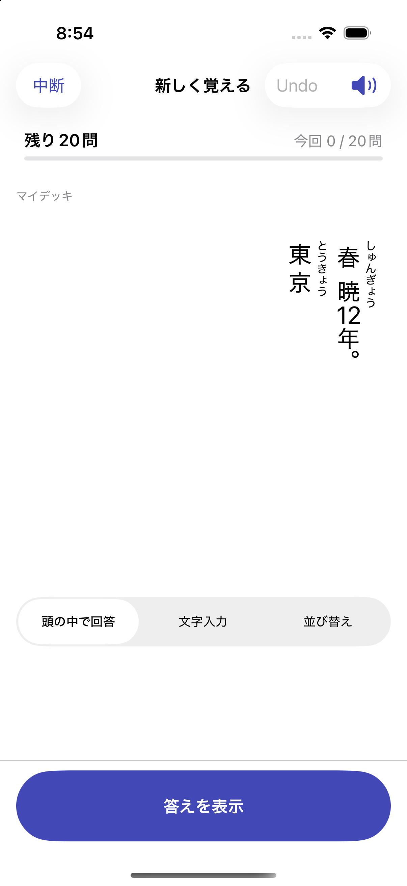
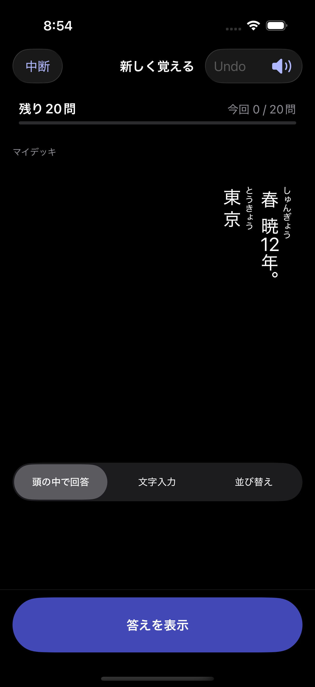

# Issue #51 検証

2026-10-11、日本時間。Xcode 27.0、iPhone 17 Pro / iOS 26.5 Simulator、最低対象iOS 17。

- 初回の既存単体・結合166件（165成功、既存1件スキップ、失敗0）。
- 追加後の関連55件成功：ルビ解析、HTMLエスケープ、原文フォールバック、2桁数字、穴埋め読みの非公開、反転、旧Codable、CSV列、UUID／FSRS／due維持、編集下書きと完全復元、英文TTS。
- UI：縦書き・複数ルビのプレビュー→解答公開→保存→学習→Good→Undo→プロセス再起動→再開が成功。
- UI回帰：通常の横書きで作成→学習→Undo→再起動→予定維持編集→削除が成功。
- シミュレーターで2列の上→下／右→左、ルビの右側配置、2桁縦中横、ライト／ダークのコントラストを目視確認。下の画像は専用テストストアの学習画面。通常データは操作していない。

結果ログ：`/private/tmp/anki-issue51-initial.log`、`/private/tmp/anki-issue51-v2.log`、`/private/tmp/anki-issue51-native-regression.log`。テスト本体は上記の通り終了しているが、UI実行後のxcodebuild診断収集が長引く場合がある。xcresultの完成とは分けて記録する。

実機、iOS17ランタイム、VoiceOver音声、長文のコピー／スクロールと横画面の手動操作は未検証。拡大文字・iPhone SEは利用者指定で省略。
