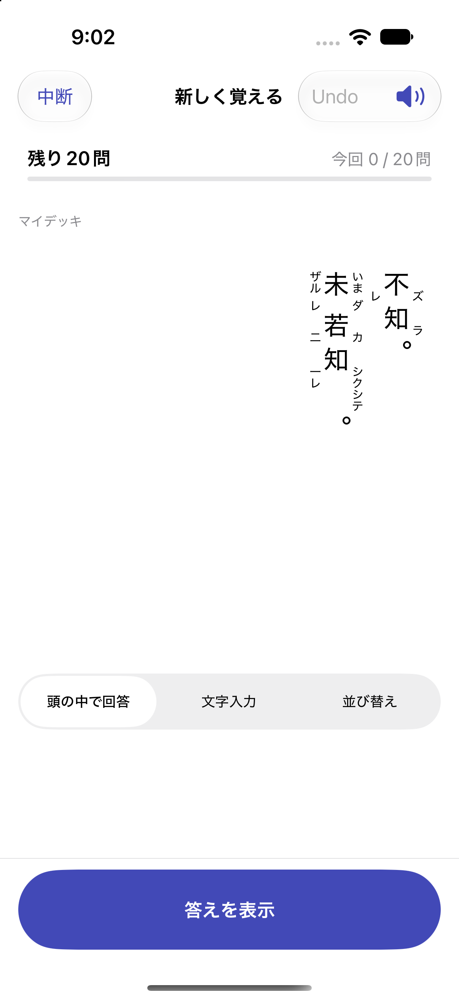
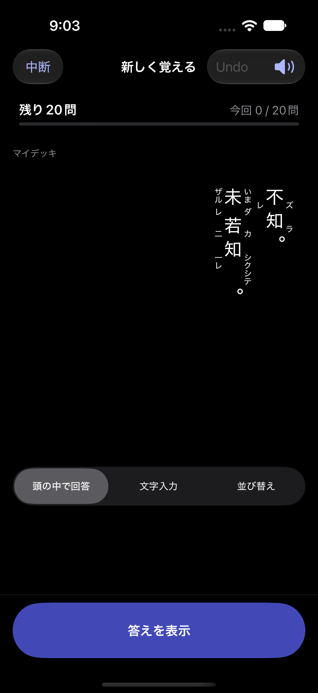

# Issue #52 検証

2026-10-11、日本時間。#51（PR #74）をベースに実装。

- iPhone 18 Pro / iOS 27.0 Simulator：関連51件成功。単独・複合返り点、同一字の送り仮名と返り点、右ルビ・再読左ルビ、入力不備・未知注記・重複・HTMLエスケープ、穴埋めの読み保護、共通ルビ回帰。
- 同端末のUI1件と結合1件成功：訓点付き本文を入力→プレビュー→解答公開→保存→学習→Good→Undo→プロセス再起動→再開。原文編集とCSV更新、編集下書き・完全復元、カードUUID・FSRS・due・ReviewLog保持も確認。
- iPhone 17 Pro / iOS 26.5 Simulator：最終関連51件成功。2000字の訓点付き本文と200KB超過の原文フォールバックを含む。
- 専用テストストアで小書きの返り点が左下、送り仮名が右下、再読ルビが左、通常ルビが右に配置されること、長い送り仮名が次の字と重ならないこと、ライト／ダークを目視確認。

ログ：`/private/tmp/anki-issue52-v2.log`、`/private/tmp/anki-issue52-ui.log`、`/private/tmp/anki-issue52-final.log`。最終関連テストは `TEST SUCCEEDED`。UI本体は成功したが、xcodebuildの診断収集／xcresult最終化が長引く場合があり、テスト本体の結果と区別する。

実機・iOS17ランタイム・VoiceOver音声・横画面と長文の手動操作は未検証。拡大文字・iPhone SEは依頼に従い省略。
